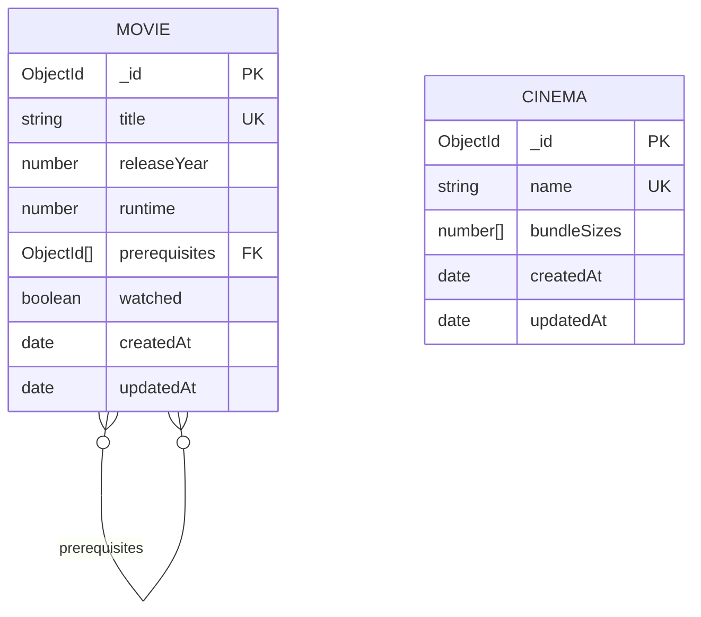

# Doomsday Ready

A full-stack application for MCU fans to manage movies, generate prerequisite-based rewatch plans, and calculate exact watch-party seat bundle combinations.

## Features

### 1. Movies and rewatch order
- Create movies with a unique title, release year, runtime (1–300 minutes), optional prerequisites, and a watched status (defaults to `false`).
- Update movie details, prerequisites, and watched status.
- Reject prerequisite updates that introduce a direct or indirect circular dependency with HTTP `409` and the error code `CIRCULAR_DEPENDENCY`.
- Generate a rewatch order containing every prerequisite and its prerequisites exactly once, with prerequisites appearing before dependent movies. The selected target movie is excluded.
- Return the number of watched prerequisite movies and the combined runtime of unwatched prerequisite movies.

### 2. Cinemas and watch-party booking
- Create cinemas with a unique name and 1–10 distinct bundle sizes. Each bundle size must be an integer from 1 to 500 seats.
- Calculate a booking quote for a group of 1–10,000 people.
- Return an exact seat total using the fewest possible bundles, including the count of each bundle size. A bundle size can be used repeatedly.
- Return `possible: false` when no exact combination exists.

### 3. Frontend
The React interface has three views:
- **Movies:** add movies, edit prerequisites, and mark movies as watched.
- **Rewatch Plan:** choose a target movie and see its ordered prerequisites, watched progress, and remaining runtime.
- **Booking:** create/select a cinema, enter a group size, and view the minimum-bundle quote or an impossible result.

## Tech stack

- Next.js 16 (App Router and Route Handlers)
- React 19
- JavaScript / TypeScript
- MongoDB with Mongoose
- CSS and Tailwind CSS tooling included in the project

## Requirements

- Node.js 22 or later
- npm
- MongoDB  (local installation or Docker)

## Run locally

1. Clone the repository and enter the project directory.
2. Install dependencies:

   ```bash
   npm install
   ```

3. Create `.env.local` in the project root:

   ```env
   MONGODB_URI=mongodb://127.0.0.1:27017/doomsday_ready
   ```

   Replace the URI if your MongoDB instance uses a different host, port, database, or authentication configuration.

4. Start the development server:

   ```bash
   npm run dev
   ```

5. Open [http://localhost:3000](http://localhost:3000).

## Run with Docker Compose

Docker Compose starts the Next.js application and MongoDB together:

```bash
docker compose up --build
```

Open [http://localhost:3000](http://localhost:3000). MongoDB data is persisted in the `mongodb_data` Docker volume.

To stop the services:

```bash
docker compose down
```

To stop the services and delete the persisted database volume:

```bash
docker compose down -v
```

## Environment variables

| Variable | Required | Description | Example |
|---|---|---|---|
| `MONGODB_URI` | Yes | MongoDB connection string | `mongodb://127.0.0.1:27017/doomsday_ready` |

For Docker Compose, the application uses `mongodb://mongo:27017/doomsday_ready` internally. Do not commit `.env.local` or credentials to the repository.

## API reference

All endpoints are under `/api` and return JSON.

| Method | Endpoint | Purpose |
|---|---|---|
| `POST` | `/api/movies` | Create a movie |
| `GET` | `/api/movies` | List movies |
| `PATCH` | `/api/movies/:id` | Update movie fields, watched status, or prerequisites |
| `GET` | `/api/movies/:id/rewatch-order` | Get prerequisite order, watched count, and unwatched runtime |
| `POST` | `/api/cinemas` | Create a cinema |
| `GET` | `/api/cinemas` | List cinemas |
| `GET` | `/api/cinemas/:id/booking?groupSize=6` | Calculate an exact minimum-bundle booking quote |

### Example requests

Create a movie:

```http
POST /api/movies
Content-Type: application/json

{
  "title": "Iron Man",
  "releaseYear": 2008,
  "runtime": 126
}
```

Create a cinema:

```http
POST /api/cinemas
Content-Type: application/json

{
  "name": "Example Cinema",
  "bundleSizes": [2, 5]
}
```

Get a booking quote for 11 people:

```http
GET /api/cinemas/CINEMA_ID/booking?groupSize=11
```

### Important responses

- Invalid input: HTTP `400`.
- Missing movie or cinema: HTTP `404`.
- Duplicate movie title or cinema name: HTTP `409`.
- Circular prerequisite dependency: HTTP `409`, with `error: "CIRCULAR_DEPENDENCY"`.
- A valid booking request without an exact bundle combination returns HTTP `200` and `possible: false`.

## Algorithms

The graph traversal and booking calculation are implemented in the application code; no library is used to solve either assessment algorithm.

### Circular dependency detection — Depth-First Search (DFS)

When prerequisites are updated, the API loads the existing movie dependency graph, applies the proposed prerequisite list to that graph, and checks whether any proposed prerequisite can already reach the movie being updated. The recursive `hasPath` DFS uses a `visited` set to avoid revisiting nodes. If a path exists, adding that edge would create a cycle, so the API rejects the update with HTTP `409 CIRCULAR_DEPENDENCY`.

A single path search takes `O(V + E)` time in the worst case, where `V` is the number of movies and `E` is the number of prerequisite relationships. The check is run for each proposed prerequisite.

### Rewatch order — DFS topological ordering

The rewatch endpoint starts DFS from the selected target movie. It recursively visits prerequisites before adding the current movie to the result. A `visited` set ensures each prerequisite is included once, while a `visiting` set detects an unexpected cycle during traversal. The target movie itself is excluded from the returned list.

The traversal takes `O(V + E)` time and `O(V)` auxiliary space for the visited/traversal state, over the reachable dependency graph. After traversal, the API counts watched movies and sums the runtimes of unwatched movies.

### Booking quote — Dynamic Programming (Unbounded Coin Change)

The booking endpoint uses dynamic programming to find the minimum number of bundles whose seat counts sum exactly to the requested group size. Each bundle size may be used any number of times.

- `dp[amount]` stores the minimum number of bundles needed to make `amount` seats.
- `lastBundle[amount]` stores the bundle size selected for that amount so the final combination can be reconstructed.
- `dp[0]` is initialized to `0`; other states start at infinity.
- For every amount from `1` through the requested group size, each available bundle size is considered and the state is improved when it produces a smaller bundle count.
- If the final state remains infinity, an exact booking is not possible. Otherwise, `lastBundle` is followed backwards to count each bundle size.

For group size `G` and `B` available bundle sizes, the algorithm takes `O(G × B)` time and `O(G)` space.

## Data model

The application uses two MongoDB collections. Movie prerequisites are references to other Movie documents. Cinema bundle sizes are stored as an array of numbers embedded in the Cinema document. There is no direct relationship between movies and cinemas.



`timestamps: true` adds `createdAt` and `updatedAt` to both Mongoose documents. `title` and `name` are unique. The `prerequisites` array stores Movie ObjectId references; `bundleSizes` is embedded directly in each Cinema document.

## AI usage disclosure

AI assistance was used only during the UI design process to help with visual design ideas and styling direction.

## Assessment notes

- The sample MCU prerequisite relationships in the assessment are example data, not an official watch guide. Movies and prerequisites are entered by the user.
- A cinema can sell multiple distinct bundle sizes, and each size can be purchased repeatedly.
- Booking requires an exact seat total; unused seats are not allowed.
- The release year is validated as a positive integer in the current implementation. Runtime is validated as an integer from 1 to 300 minutes.

## Useful scripts

```bash
npm run dev    # Start the development server
npm run build  # Build the production application
npm run start  # Start the production server
npm run lint   # Run ESLint
```
